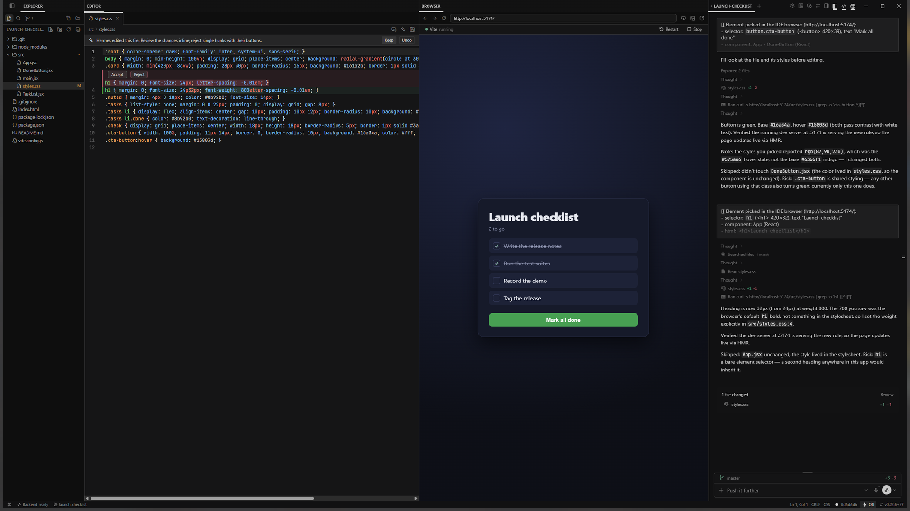
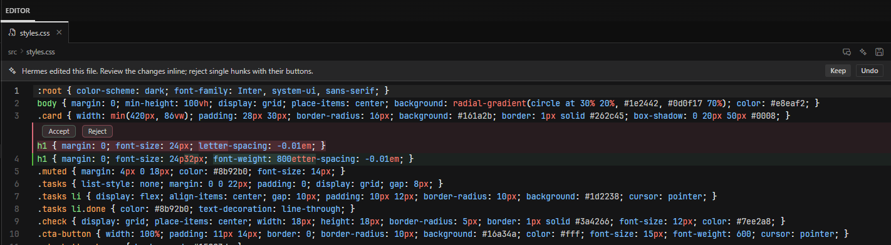

# Hermes IDE

[](LICENSE)
[](https://hermes-agent.nousresearch.com/docs/user-guide/desktop)
[](https://github.com/CoeusInstitute/hermes-ide/actions/workflows/ci.yml)

A Cursor-style IDE for [Hermes Desktop](https://hermes-agent.nousresearch.com/docs/user-guide/desktop), shipped as one installable Hermes plugin.

Press **Ctrl+Alt+I** in any chat and that chat opens in its own IDE window: an Explorer, a tabbed code editor and your project's running UI, beside the chat itself. The window is the app's own single-chat pop-out, so the chat in it is the real session, not a copy, and your main window is never rearranged.



## What you get

- **One chat, one IDE window.** Explorer, Search, Source Control, a CodeMirror 6 editor with tabs, Quick Open (Ctrl+P) and the session chat, in columns you drag into any arrangement with the app's own pane dragging.
- **The editor talks to the chat.** Ctrl+L sends the selection as an `@file:path:from-to` reference, Ctrl+K asks Hermes to edit the selected lines in place, and when the agent edits an open file you review the change inline with **Keep** and **Undo**.
- **Your project's UI, one click away.** The IDE finds the web UI in the open folder (Vite, Next.js, Nuxt, Remix, SvelteKit, Astro, Angular, Create React App and more, monorepos included, or a static `index.html`), asks once before running its code, starts the dev server, and opens the page in the app's Browser.
- **Pick an element, hand it to the agent.** Click anything on the running page and the chat gets its selector, size, text, markup, key styles and the source lines that most likely render it.
- **The session is the unit.** The open folder and the editor tabs belong to the chat, so reopening the IDE for a chat brings back its folder and files. IDE chats carry an **IDE** badge in the session list.
- **The agent can drive it.** The `ide_open` tool opens a file at a line in that chat's IDE window.

## Install

Requires Hermes **0.22.5** or newer, with Hermes Desktop.

**From the Desktop app.** Open **Capabilities → Plugins → Install from Git**, enter `CoeusInstitute/hermes-ide`, keep both the Agent plugin and Desktop UI targets checked, and click **Install**. Both halves install and turn on at once; the **IDE** button appears in the status bar without a restart.

**From a terminal.**

```bash
hermes plugins install CoeusInstitute/hermes-ide --enable
```

A terminal install enables the agent half only. Restart Hermes Desktop if it was open, then search `Hermes IDE` under **Capabilities → Plugins** and switch **Desktop: Hermes IDE** on.

**Update.** **Capabilities → Plugins** offers updates, or run `hermes plugins update hermes-ide`. An update that changes the backend (as 0.4 does) loads on the next gateway start: run `hermes gateway restart`, or restart the app. The project UI view says so when it finds the gateway still on the previous backend.

**Uninstall.** Run `hermes plugins remove hermes-ide`, then delete `desktop-plugins/hermes-ide` in your Hermes home (`%LOCALAPPDATA%\hermes` on Windows, `~/.hermes` elsewhere); the running app unloads the desktop half when that folder goes. A few small settings stay in the app's storage (tab lists, column layout, trusted projects, the IDE chat list) and are reused if you reinstall.

### Two builds of one source

| | Catalog build | Full build |
|---|---|---|
| Where | the `catalog` branch, pinned by the Hermes plugin catalog | `main` (what **Install from Git** gets) |
| Surface | the Desktop plugin SDK only: passes `hermes plugins validate` | the SDK plus a few reads of the app's own markup |
| Explorer | a resizable panel inside the Editor column | its own column |
| Project UI | a **Run** view beside Explorer, Search and Source Control; the page opens in the app's Browser pane | a Browser column of its own (address bar, DevTools, the page) |
| IDE chats | an **IDE** badge on their rows (click it to open the IDE) and an IDE chats menu on the status-bar button | the same, plus an **IDE** group under SESSIONS and a plain click on the row opening the IDE |
| Column widths | the app's split; your resizes are kept while the window is open | fitted on open and remembered per chat |

The full build exists because the SDK has no hook yet for a session-list group, for sizing a split, or for pointing the app's Browser at an address. Those hooks are requested upstream; as each lands, its feature moves into the catalog build. Build either one with `npm run build` (catalog) or `npm run build:full` in `dev/`.

## Use

In a chat, press **Ctrl+Alt+I**, click **IDE** in the status bar, or run **IDE: Open in IDE Window** from the command palette. The IDE opens the chat on screen; from a page such as Capabilities it asks you to open a chat first. The chat needs one message first, because a draft has no session yet. If the chat already has a plain pop-out window, that window turns into the IDE.

The IDE window maximizes, hides the session list (it holds one chat), and opens its columns beside the chat.

### Columns

- **Rearrange** by dragging a column's tab to any edge of another column, or onto its middle to stack them as tabs. This is the app's own pane dragging.
- **Show or hide** columns with the toggles at the top right of the IDE window, or the **IDE: Toggle … Column** commands. Ctrl+B in the editor toggles the Explorer.
- **Resize** by dragging any seam. In the catalog build, drag the line between the Explorer panel and the editor (double-click it for the default width; arrow keys move it when it has focus).
- **IDE: Reset Column Layout** goes back to the default.

Every column's first bar is the same height, so the rows line up across the window.

### Editor

| Keys in the editor | Action |
|---|---|
| Ctrl+L | Add the selection (or the file) to the chat as an `@file:` reference |
| Ctrl+K | Edit the selected lines with Hermes; the request goes to the session chat |
| Ctrl+P | Go to file (`name:line` jumps to a line) |
| Ctrl+Shift+F | Search in files |
| Ctrl+S / Ctrl+Shift+S | Save / Save all |
| Ctrl+F, Ctrl+G, Ctrl+D, Ctrl+/ | Find, go to line, select next match, toggle comment |
| Ctrl+Shift+P or F1 | The Desktop command palette |
| Ctrl+B | Toggle the Explorer |
| Ctrl+Alt+Left / Right, Ctrl+PageUp / PageDown | Previous / next tab |

Outside the editor the same commands have palette entries (`IDE: …`) and rebindable defaults: Ctrl+Alt+I (open or show the IDE), Ctrl+Alt+P (go to file), Ctrl+Alt+F (search), Ctrl+Alt+B (project UI), Ctrl+Alt+R (run the project's UI). An empty editor lists the main ones as clickable rows.

The editor runs in its own document inside the IDE, so the app's global shortcuts never take Ctrl+D, Ctrl+F, Ctrl+K or Ctrl+P from it. Unsaved text is mirrored to plugin storage, so a crash or reload never loses it; if the agent changed the file meanwhile, the IDE shows both versions instead of overwriting either.

**Agent edits.** When Hermes edits an open file, the tab reloads with an inline diff against the text before the turn. Accept or reject single hunks, or use **Keep** and **Undo** for the whole edit. If you had unsaved changes, you get **Compare**, **Use Disk Version** and **Overwrite with Mine** instead, and nothing is lost. Renaming a file or folder in the Explorer carries its open tabs along, unsaved edits included.



### Project UI

When the IDE opens a folder, it looks for a web UI: a `package.json` whose dev script runs a known framework's command (at the root, one level down, or under `apps/*` and `packages/*`), or a static `index.html`. The package manager comes from the lockfile (pnpm, yarn, bun or npm).

- **The first time, the IDE asks** before running anything: **Always run for this project**, **Run once**, or **Not now**. A dev server runs that project's own code, so the IDE never starts one unasked. Trust is tied to the folder and the exact script: if the dev script changes (a pull, an agent edit), the IDE asks again. **Settings → Hermes IDE** lists trusted projects with **Revoke**.
- A trusted project starts by itself when its IDE window opens (turn that off in **Settings → Hermes IDE**). Without `node_modules` the button reads **Install & run**.
- The URL comes from the dev server's own output, so a different port is picked up. The status row shows the state; click it for the live log, which also opens by itself when a server exits with an error. **Restart** and **Stop** sit beside it.
- The dev server belongs to the IDE window: two minutes after the last IDE window that asked about it closes, the backend stops it and its child processes.

**Catalog build.** The project's controls are the Explorer panel's **Run** view (the ▶ tab; a dot on it means a UI was found or is running). When the server is up, click **Open localhost:… in the Browser**: the page opens in the app's own Browser pane (Ctrl+click opens your system browser). The plugin SDK cannot point that Browser at an address by itself, so this one click is yours.

**Full build.** The page shows in the IDE's own Browser column, with an address bar, back, forward, reload, DevTools and **Open externally**.

**Pick an element** with the inspect button (or **IDE: Pick Element in Browser**): hover the page, click an element, and the chat composer gets its selector, size, text, markup, key styles and up to three likely source lines (`@file:` references found by searching the project for its id, text or most specific class). Press Esc, or the button again, to cancel. In the catalog build the app asks once per site before the IDE may run its picker there (**Allow on this site**); grants are listed on the plugin's row in **Capabilities → Plugins**.

### IDE chats

A chat becomes an IDE chat the first time it opens in an IDE window. Its row in the session list carries an **IDE** badge wherever the app draws it (Pinned, date groups, projects, search); click the badge to open its IDE window. The small arrow beside **IDE** in the status bar lists every IDE chat (pinned first), opens any of them in its window, starts a **New IDE chat** (it opens in the IDE after your first message), and removes a chat from the list with **×**.

The full build also lists IDE chats in their own **IDE** group under SESSIONS (in the date-grouped list), takes them out of the date groups, and opens the IDE on a plain click anywhere on the row.

### The agent drives the IDE

`ide_open` with a `path` (and optional `line`) opens the file in that chat's IDE window, opening the window when needed. With a `url` it offers the page in the project UI view (the full build shows it in its Browser column). For a page in the app's Browser pane, the agent's built-in `open_preview` tool does it directly.

## Security and privacy

What the plugin does on your machines, so you can decide before installing:

- **Files.** The backend runs inside your Hermes gateway (the agent's machine) with your user's rights, behind the gateway's own authentication, and reaches the files the agent's file tools reach. It refuses Hermes credential files in every Hermes home and profile (`.env` and its backups, `auth.json`, OAuth and API token files, client secrets, app passwords, Honcho's key, key files, `mcp-tokens/`, `secrets/`) under any spelling of the path (case, `\\?\` prefixes, symlinks), and never returns them from a listing, Quick Open or search. Your projects' own `.env` files open normally.
- **No data loss.** Deletes go to the system trash or are refused (on Windows the system asks before deleting anything it cannot recycle). Create and rename never overwrite. A save is refused when the file changed on disk since it was loaded, or was deleted.
- **Shell commands.** `git status` and `git show` (read-only, with optional locks off so they never block the agent's commits), `rg` for search, and, only for projects you trust, the project's own package manager (`install`, then its dev script).
- **Background processes.** Dev servers you start, in their own process group, stopped two minutes after the last IDE window that asked about them closes, and when the gateway exits. They run with the gateway's environment minus anything that looks like a credential (`*KEY*`, `*TOKEN*`, `*SECRET*`, `*PASSWORD*`, Hermes' own variables), with `BROWSER=none`. A static site is served on `127.0.0.1` by the plugin's own server, which never serves dotfiles or folder listings and answers only a `localhost` Host header.
- **Page scripts.** The element picker and page reload run a script in the page you opened: in the catalog build only in the app's Browser and only on sites you allowed through the app's own prompt; in the full build in the IDE's own Browser column. The picked element's text and markup go to your chat composer, nowhere else.
- **Network.** None to third parties. The plugin talks only to your Hermes gateway and to the dev servers it starts on your machine.
- **Credentials, telemetry.** The plugin stores no credentials and sends no telemetry or usage data.
- **Desktop surface.** The catalog build stays inside the Desktop plugin SDK, with one exception: a single call to the app's own title-bar maximize (`window.hermesDesktop.windowControls.toggleMaximize`), because the SDK has no window verb and an IDE does not fit the app's 420 px pop-out. The full build also reads the app's pane and session-list markup for the features in the table above.

## Known limits

- No language server yet: highlighting, folding, brackets and word completion, but no go-to-definition or diagnostics.
- Python web UIs (Streamlit, Flask, Django, Gradio) are not detected yet. Open their address in the app's Browser.
- Against a remote Hermes backend, the dev server runs on the remote machine, so its `localhost` page is not reachable from this one.
- A draft chat cannot be moved to a folder by a plugin; the IDE applies the folder after the chat's first reply. To start a chat in a folder, use the composer's folder button.
- Files that are not UTF-8 (Latin-1, UTF-16) open as binary and are not edited.
- The Explorer has no keyboard tree navigation or multi-select yet.
- The app's terminal has no plugin action, so the IDE has no Terminal toggle; use the app's own (Ctrl+` with the chat focused).
- The catalog build cannot size a column the app docks; your resizes last while the window is open. The full build's column sizing and IDE group depend on the app's markup, so a Desktop update can break them; the IDE then falls back to the app's even split and the badges.

## How it fits together

| Part | Where | What it does |
|---|---|---|
| Desktop half | `desktop/plugin.js`, built from `src/` | Main window: the IDE status button and IDE chats menu, the open command, the row badge (full build: the sidebar IDE group). IDE window (a claimed single-session pop-out): Explorer, Editor and project UI as app tiles, layout toggles, Quick Open, commands, keybinds, the element picker. Both: settings page, the `::hermes-ide-open` transcript card |
| Editor | `src/frame/editor.ts`, mounted into the editor's iframe | CodeMirror 6 with the app's theme tokens and fonts; owns its keyboard |
| Backend | `dashboard/plugin_api.py`, `dashboard/static_server.py` → `/api/plugins/hermes-ide/` | File system, ripgrep search, Quick Open file list, git status and `HEAD` text, project UI detection and the dev-server manager, on the machine the agent runs on |
| Agent half | `__init__.py`, `plugin.yaml` | The `ide_open` tool |

Details: [docs/ARCHITECTURE.md](docs/ARCHITECTURE.md). Features, gates and what comes next: [docs/FEATURES.md](docs/FEATURES.md). Changes: [CHANGELOG.md](CHANGELOG.md). Catalog submission: [docs/CATALOG-SUBMISSION.md](docs/CATALOG-SUBMISSION.md).

## Develop

```bash
cd dev && npm ci
npm run build          # catalog build → desktop/plugin.js
npm run build:full     # full build → desktop/plugin.js
npm test               # helper and layout tests
cd .. && uv run --with pytest --with fastapi --with httpx python -m pytest tests -q
hermes plugins validate .   # the catalog's admission checks (catalog build)
```

[docs/DEVELOPING.md](docs/DEVELOPING.md) covers the live loop, the release steps and the sandboxed Desktop used to verify releases.

## License

MIT. Copyright (c) 2026 Coeus Institute.
