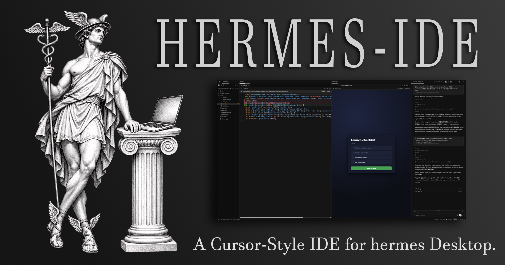
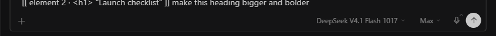
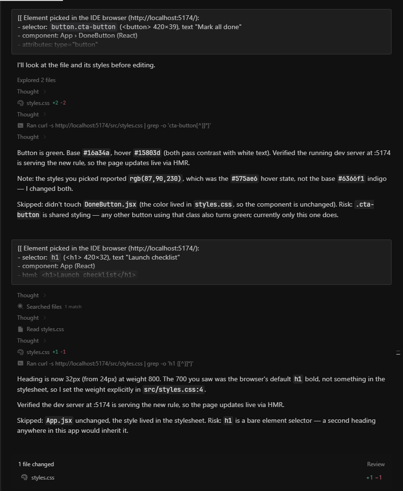

[](CHANGELOG.md)
[](https://hermes-agent.nousresearch.com/docs/user-guide/desktop)
[](https://github.com/CoeusInstitute/hermes-ide/actions/workflows/ci.yml)
[](#security-and-privacy)
[](LICENSE)

**Your code, your running app and the agent in one window, built on the chat you already have.**

[Quick start](#quick-start) · [Features](#features) · [Usage](#usage) · [Security](#security-and-privacy) · [Architecture](docs/ARCHITECTURE.md) · [Changelog](CHANGELOG.md)


<details>
<summary><b>Table of contents</b></summary>

- [About](#about)
- [Features](#features)
- [Quick start](#quick-start)
- [Install](#install)
- [Usage](#usage)
  - [Start a project](#start-a-project)
  - [Columns](#columns)
  - [Editor](#editor)
  - [Project UI](#project-ui)
  - [Pick an element](#pick-an-element)
  - [IDE chats](#ide-chats)
  - [The agent and the IDE](#the-agent-and-the-ide)
- [Two builds of one source](#two-builds-of-one-source)
- [Security and privacy](#security-and-privacy)
- [Known limits](#known-limits)
- [How it fits together](#how-it-fits-together)
- [Develop](#develop)
- [Roadmap](#roadmap)
- [Contributing](#contributing)
- [Acknowledgements](#acknowledgements)
- [License](#license)

</details>

## About

Hermes IDE turns any [Hermes Desktop](https://hermes-agent.nousresearch.com/docs/user-guide/desktop) chat into a Cursor-style workspace, shipped as one installable Hermes plugin.

Each chat gets its own IDE window: an Explorer, a tabbed code editor and your project's running UI, docked beside the chat itself. The window is the app's own single-chat pop-out, so the chat in it is the real session, not a copy, and your main window is never rearranged.

It is built for front-end and full-stack work. Point at an element on the running page, say what you want, and review the agent's edit inline while the page updates beside it.

## Features

|  |  |
|---|---|
| **One chat, one IDE window** | Explorer, Search, Source Control, a CodeMirror 6 editor with tabs, Quick Open (Ctrl+P) and the session chat, in columns you drag into any arrangement. |
| **Your project's UI, one click away** | Finds the web UI in the open folder (Vite, Next.js, Nuxt, Remix, SvelteKit, Astro, Angular, Create React App and more, monorepos included, or a static `index.html`), asks once before running its code, starts the dev server and shows the page. |
| **Pick an element, hand it to the agent** | Click anything on the running page. The composer gets a one-line token; the agent gets the selector, size, text, markup, key styles, the component chain and the source lines that most likely render it. |
| **Review every agent edit inline** | When the agent edits an open file, the tab shows a diff against the text before the turn. Accept or reject single hunks, or **Keep** and **Undo** the whole edit. |
| **The editor talks to the chat** | Ctrl+L sends the selection as an `@file:path:from-to` reference. Ctrl+K asks Hermes to edit the selected lines in place. |
| **The session is the unit** | The folder, tabs and layout belong to the chat. Reopening a chat's IDE brings them back, and IDE chats are marked in the session list. |
| **The agent can drive it** | The `ide_open` tool opens a file at a line, shows a page, or runs the project's UI. A bundled skill teaches the agent how the IDE works. |

**Pick an element.** One short token in the composer, written around like any other words:



When you send, each token becomes a full description between `[[` and `]]`, and the agent works from it. Two picks and two edits, each checked against the running dev server:



**Review the edit where it landed.** The agent's change to `styles.css` opens as an inline diff, with **Accept** and **Reject** per hunk and **Keep** or **Undo** for the whole edit:


## Quick start

1. In Hermes Desktop, open **Capabilities → Plugins → Install from Git**, enter `CoeusInstitute/hermes-ide` and click **Install**.
2. Click **IDE** in the status bar. A new IDE workspace opens and asks for a project folder.
3. Pick a folder with a web app, choose **Always run for this project**, then click the inspect button above the page, click an element and tell the chat what to change.

## Install

Requires Hermes **0.22.5** or newer, with Hermes Desktop.

**From the plugin catalog.** Once Hermes IDE is listed, search **Hermes IDE** under **Capabilities → Plugins**, or run `hermes plugins install hermes-ide`. The catalog installs the reviewed catalog build at its pinned commit.

**From the Desktop app.** Open **Capabilities → Plugins → Install from Git**, enter `CoeusInstitute/hermes-ide`, keep both the Agent plugin and Desktop UI targets checked, and click **Install**. Both halves install and turn on at once; the **IDE** button appears in the status bar without a restart.

**From a terminal.**

```bash
hermes plugins install CoeusInstitute/hermes-ide --enable
```

A terminal install enables the agent half only. Restart Hermes Desktop if it was open, then search `Hermes IDE` under **Capabilities → Plugins** and switch **Desktop: Hermes IDE** on.

<details>
<summary><b>Update</b></summary>

**Capabilities → Plugins** offers updates, or run `hermes plugins update hermes-ide`. An update that changes the backend loads on the next gateway start: run `hermes gateway restart`, or restart the app. The IDE says so when it finds the gateway still on the previous backend.

</details>

<details>
<summary><b>Uninstall</b></summary>

Run `hermes plugins remove hermes-ide`, then delete `desktop-plugins/hermes-ide` in your Hermes home (`%LOCALAPPDATA%\hermes` on Windows, `~/.hermes` elsewhere); the running app unloads the desktop half when that folder goes. A few small settings stay in the app's storage (tab lists, column layout, trusted projects, the IDE chat list) and are reused if you reinstall.

</details>


## Usage

### Start a project

- **New workspace:** click **IDE** in the status bar. A new IDE workspace opens in its own window and asks for the project folder: pick one, or type a new path and choose **Create folder**. The workspace is a new chat that works in that folder, takes the folder's name after its first message, and is listed with your IDE chats.
- **Open the chat you are in:** press **Ctrl+Alt+I**, or run **IDE: Open in IDE Window** from the command palette. The chat needs one message first, because a draft has no session yet. If the chat already has a plain pop-out window, that window turns into the IDE.

The IDE window maximizes, hides the session list (it holds one chat) and opens its columns beside the chat: the Explorer first (300 px at most), then the project's page, a little wider than the chat. The Editor opens beside the Explorer with the first file you open, and the columns rebalance so the editor gets the most room.

### Columns

- **Rearrange** by dragging a column's tab to any edge of another column, or onto its middle to stack them as tabs. This is the app's own pane dragging.
- **Show or hide** columns with the toggles at the top right of the IDE window, or the **IDE: Toggle … Column** commands. Ctrl+B in the editor toggles the Explorer.
- **Resize** by dragging any seam. Widths are remembered per chat and per set of open columns. In the catalog build, drag the line between the Explorer panel and the editor (double-click it for the default width; arrow keys move it when it has focus).
- **IDE: Reset Column Layout** goes back to the default.

Every column's first bar is the same height, so the rows line up across the window.

### Editor

| Keys in the editor | Action |
|---|---|
| Ctrl+L | Add the selection (or the file) to the chat as an `@file:` reference |
| Ctrl+K | Edit the selected lines with Hermes; the request goes to the session chat |
| Ctrl+P | Go to file (`name:line` jumps to a line) |
| Ctrl+Shift+F | Search in files |
| Ctrl+S / Ctrl+Shift+S | Save / Save all |
| Ctrl+F, Ctrl+G, Ctrl+D, Ctrl+/ | Find, go to line, select next match, toggle comment |
| Ctrl+Shift+P or F1 | The Desktop command palette |
| Ctrl+B | Toggle the Explorer |
| Ctrl+Alt+Left / Right, Ctrl+PageUp / PageDown | Previous / next tab |

Outside the editor the same commands have palette entries (`IDE: …`) and rebindable defaults: Ctrl+Alt+I (open or show the IDE), Ctrl+Alt+P (go to file), Ctrl+Alt+F (search), Ctrl+Alt+B (project UI), Ctrl+Alt+R (run the project's UI). An empty editor lists the main ones as clickable rows.

The editor runs in its own document inside the IDE, so the app's global shortcuts never take Ctrl+D, Ctrl+F, Ctrl+K or Ctrl+P from it. Unsaved text is mirrored to plugin storage, so a crash or reload never loses it; if the agent changed the file meanwhile, the IDE shows both versions instead of overwriting either.

**Agent edits.** When Hermes edits a file that is open, the tab reloads with an inline diff against the text before the turn. Accept or reject single hunks, or use **Keep** and **Undo** for the whole edit. If you had unsaved changes, you get **Compare**, **Use Disk Version** and **Overwrite with Mine** instead, and nothing is lost. Renaming a file or folder in the Explorer carries its open tabs along, unsaved edits included.

### Project UI

When the IDE opens a folder, it looks for a web UI: a `package.json` whose dev script runs a known framework's command (at the root, one level down, or under `apps/*` and `packages/*`), or a static `index.html`. The package manager comes from the lockfile (pnpm, yarn, bun or npm).

- **The first time, the IDE asks** before running anything: **Always run for this project**, **Run once**, or **Not now**. A dev server runs that project's own code, so the IDE never starts one unasked. Trust is tied to the folder and the exact script: if the dev script changes (a pull, an agent edit), the IDE asks again. **Settings → Hermes IDE** lists trusted projects with **Revoke**.
- A trusted project starts by itself when its IDE window opens (turn that off in **Settings → Hermes IDE**). Without `node_modules` the button reads **Install & run**.
- The URL comes from the dev server's own output, so a different port is picked up. The status row shows the state; click it for the live log, which also opens by itself when a server exits with an error. **Restart** and **Stop** sit beside it.
- The dev server belongs to the IDE window: two minutes after the last IDE window that asked about it closes, the backend stops it and its child processes.

**Full build.** The page shows in the IDE's own Browser column, with an address bar, back, forward, reload, DevTools and **Open externally**.

**Catalog build.** The project's controls are the Explorer panel's **Run** view (the ▶ tab; a dot on it means a UI was found or is running). When the server is up, click **Open localhost:… in the Browser**: the page opens in the app's own Browser pane (Ctrl+click opens your system browser). The plugin SDK cannot point that Browser at an address by itself, so this one click is yours.

### Pick an element

Click the inspect button above the page (or run **IDE: Pick Element in Browser**), hover the page and click an element. The composer gets one short token for it, such as `[[ element 3 · <button.cta-button> "Mark all done" ]]`. Pick as many as you like and write around them. When you send, each token becomes the element's full description, between `[[` and `]]` so the model sees where each element starts and ends:

```
[[ Element picked in the IDE browser (http://localhost:5173/):
- selector: `button.cta-button` (<button> 420×39), text "Mark all done"
- component: App › DoneButton (React)
- attributes: type="button"
- html: `<button class="cta-button" type="button">Mark all done</button>`
- styles: display: inline-block; color: rgb(255, 255, 255); background-color: rgb(99, 102, 241); ...
- source: @file:src/DoneButton.jsx:3
]]
```

- **Source.** In a development build of a React (up to 18), Vue or Svelte app, the IDE reads the component chain and the exact source line that rendered the element. Otherwise it searches the project for the element's id, text or most specific class and lists up to three likely source lines.
- **Selector.** A test id (`data-testid`, `data-test`, `data-cy`, `data-qa`) or a unique id when there is one, else the shortest tag and class path that matches only that element. Elements inside an open shadow root get the host's selector, then `>>>`.
- **Cancel** with Esc, a right-click, or the pick button again. The highlight follows scrolling.
- The page address is a plain link, not an `@url:` reference: Hermes would fetch the whole page into every message, and refuses `localhost` pages anyway.
- In the catalog build the app asks once per site before the IDE may run its picker there (**Allow on this site**); grants are listed on the plugin's row in **Capabilities → Plugins**.

### IDE chats

A chat becomes an IDE chat the first time it opens in an IDE window. Its row in the session list carries an **IDE** badge wherever the app draws it (Pinned, date groups, projects, search); click the badge to open its IDE window. The small arrow beside **IDE** in the status bar lists every IDE chat (pinned first), opens any of them in its window, opens the chat on screen in the IDE, starts a **New IDE workspace**, and removes a chat from the list with **×**.

The full build also lists IDE chats in their own **IDE** group under SESSIONS (in the date-grouped list), takes them out of the date groups, and opens the IDE on a plain click anywhere on the row. Its **+** starts a new IDE workspace.

### The agent and the IDE

**The agent drives the IDE.** Ask the chat to "open the project's UI in the IDE browser" and the agent calls `ide_open` with `ui: true`: the IDE detects the project's UI, runs its dev server with its own manager (asking you first if you have not trusted the project; click **Always run** or **Run once** while it waits) and shows the page. The agent never starts a dev server of its own for the IDE, so nothing is left running in the chat.

`ide_open` with a `path` (and optional `line`) opens a file in that chat's IDE window; with a `url`, a page that is already running. The IDE window opens when needed, and the tool waits for its answer: `running` (with the URL), `needs_trust`, `starting`, `opened`, `no_ui`, `no_folder`, `error`, or `no_window` when no Hermes IDE window answered. In the catalog build the page goes to the app's Browser pane through the agent's built-in `desktop_preview` tool (action `open`).

**The agent knows about the IDE.**

- While a chat's IDE window is open, each turn in that chat carries a short **[Hermes IDE]** note: the message comes from the IDE, what the user sees beside the chat, what a `[[ Element picked … ]]` block is, and which tools put things in front of them. The note is added to that turn only. It is not stored in the transcript and does not change the system prompt, so the prompt cache is untouched. A message that carries a picked element gets the note even after the window closes.
- The plugin bundles a skill, **`hermes-ide:guide`**, listed in the agent's skill index while the plugin is enabled: how the IDE works, how to answer an element pick (find the source, change it rather than built output), and what the user sees after an edit.


## Two builds of one source

|  | Catalog build | Full build |
|---|---|---|
| Where | a tagged commit per release (`catalog-v0.6.5`), pinned by the Hermes plugin catalog | `main` (what **Install from Git** gets) |
| Surface | the Desktop plugin SDK only: passes `hermes plugins validate` | the SDK plus a few reads of the app's own markup |
| Explorer | a resizable panel inside the Editor column | its own column |
| Project UI | a **Run** view beside Explorer, Search and Source Control; the page opens in the app's Browser pane | a Browser column of its own (address bar, DevTools, the page) |
| IDE chats | an **IDE** badge on their rows (click it to open the IDE) and an IDE chats menu on the status-bar button | the same, plus an **IDE** group under SESSIONS and a plain click on the row opening the IDE |
| Column widths | the app's split; your resizes are kept while the window is open | fitted on open and remembered per chat |

The full build exists because the SDK has no hook yet for a session-list group, for sizing a split, or for pointing the app's Browser at an address. Those hooks are requested upstream; as each lands, its feature moves into the catalog build. Build either one with `npm run build` (catalog) or `npm run build:full` in `dev/`.

## Security and privacy

What the plugin does on your machines, so you can decide before installing:

- **Files.** The backend runs inside your Hermes gateway (the agent's machine) with your user's rights, behind the gateway's own authentication, and reaches the files the agent's file tools reach. It refuses Hermes credential files in every Hermes home and profile (`.env` and its backups, `auth.json`, OAuth and API token files, client secrets, app passwords, Honcho's key, key files, `mcp-tokens/`, `secrets/`) under any spelling of the path (case, `\\?\` prefixes, symlinks), and never returns them from a listing, Quick Open or search. Your projects' own `.env` files open normally.
- **No data loss.** Deletes go to the system trash or are refused (on Windows the system asks before deleting anything it cannot recycle). Create and rename never overwrite. A save is refused when the file changed on disk since it was loaded, or was deleted.
- **Shell commands.** `git status` and `git show` (read-only, with optional locks off so they never block the agent's commits), `rg` for search, and, only for projects you trust, the project's own package manager (`install`, then its dev script).
- **Background processes.** Dev servers you start, in their own process group, stopped two minutes after the last IDE window that asked about them closes, and when the gateway exits. They run with the gateway's environment minus anything that looks like a credential (`*KEY*`, `*TOKEN*`, `*SECRET*`, `*PASSWORD*`, Hermes' own variables), with `BROWSER=none`. A static site is served on `127.0.0.1` by the plugin's own server, which never serves dotfiles or folder listings and answers only a `localhost` Host header.
- **Page scripts.** The element picker and page reload run a script in the page you opened: in the catalog build only in the app's Browser and only on sites you allowed through the app's own prompt; in the full build in the IDE's own Browser column. The picked element's description waits in that window's session storage until you send it, and goes nowhere but your chat.
- **Agent context.** The `pre_llm_call` hook adds the [Hermes IDE] note above to turns of chats whose IDE window is open. To know which chats those are, an open IDE window writes its chat's ids and a timestamp to `plugin-data/hermes-ide/ide-sessions.json` in your Hermes home every minute; nothing else is stored there.
- **Network.** None to third parties. The plugin talks only to your Hermes gateway and to the dev servers it starts on your machine.
- **Credentials, telemetry.** The plugin stores no credentials and sends no telemetry or usage data.
- **Install scan.** Hermes' install scanner rates the plugin `safe`: no critical or high finding, so installing from Git needs no confirmation. Its medium and low notes (character handling inside the bundled CodeMirror, the backend's subprocess calls, test fixtures) are listed in [docs/CATALOG-SUBMISSION.md](docs/CATALOG-SUBMISSION.md).
- **Desktop surface.** The catalog build stays inside the Desktop plugin SDK, with one exception: a single call to the app's own title-bar maximize (`window.hermesDesktop.windowControls.toggleMaximize`), because the SDK has no window verb and an IDE does not fit the app's 420 px pop-out. The full build also reads the app's pane and session-list markup for the features in the table above.

## Known limits

- The inline review covers files that are open when the agent edits them. A file the agent changed while it was closed opens with the new text; the chat's own **Review** card still shows that change.
- No language server yet: highlighting, folding, brackets and word completion, but no go-to-definition or diagnostics.
- Python web UIs (Streamlit, Flask, Django, Gradio) are not detected yet. Open their address in the app's Browser.
- Against a remote Hermes backend, the dev server runs on the remote machine, so its `localhost` page is not reachable from this one.
- A draft chat cannot be moved to a folder by a plugin; the IDE applies the folder after the chat's first reply. To start a chat in a folder, use the composer's folder button.
- Files that are not UTF-8 (Latin-1, UTF-16) open as binary and are not edited.
- The Explorer has no keyboard tree navigation or multi-select yet.
- The app's terminal has no plugin action, so the IDE has no Terminal toggle; use the app's own (Ctrl+` with the chat focused).
- Catalog build: the Explorer is a panel inside the Editor column, so that column is always there (with the shortcut list until a file opens), and the app sizes its own Browser pane. It cannot size a column the app docks; your resizes last while the window is open.
- Full build: column sizing and the IDE group depend on the app's markup, so a Desktop update can break them; the IDE then falls back to the app's even split and the badges.


## How it fits together

| Part | Where | What it does |
|---|---|---|
| Desktop half | `desktop/plugin.js`, built from `src/` | Main window: the IDE status button and IDE chats menu, the open command, the row badge (full build: the sidebar IDE group). IDE window (a claimed single-session pop-out): Explorer, Editor and project UI as app tiles, layout toggles, Quick Open, commands, keybinds, the element picker. Both: settings page, the `::hermes-ide-open` transcript card |
| Editor | `src/frame/editor.ts`, mounted into the editor's iframe | CodeMirror 6 with the app's theme tokens and fonts; owns its keyboard |
| Backend | `dashboard/plugin_api.py`, `dashboard/static_server.py` → `/api/plugins/hermes-ide/` | File system, ripgrep search, Quick Open file list, git status and `HEAD` text, project UI detection and the dev-server manager, on the machine the agent runs on |
| Agent half | `__init__.py`, `plugin.yaml`, `skills/guide/` | The `ide_open` tool, the [Hermes IDE] turn note and the `hermes-ide:guide` skill |

| Document | What it covers |
|---|---|
| [docs/ARCHITECTURE.md](docs/ARCHITECTURE.md) | Windows, builds, data flow and the decisions behind them |
| [docs/FEATURES.md](docs/FEATURES.md) | Every feature with its Cursor counterpart, wiring and acceptance test, by gate |
| [docs/DEVELOPING.md](docs/DEVELOPING.md) | The live loop, the release steps and the sandboxed Desktop used to verify releases |
| [docs/CATALOG-SUBMISSION.md](docs/CATALOG-SUBMISSION.md) | The catalog entry, the PR text and the install-scan disclosure |
| [CHANGELOG.md](CHANGELOG.md) | What changed in each release |

## Develop

```bash
cd dev && npm ci
npm run build          # catalog build → desktop/plugin.js
npm run build:full     # full build → desktop/plugin.js
npm test               # helper, layout and grammar-table tests
node picker-check.mjs  # the element picker in a local Chrome or Edge, real mouse input
cd .. && python -m pytest tests -q   # with pytest, fastapi and httpx installed; see docs/DEVELOPING.md
hermes plugins validate .   # the catalog's admission checks (catalog build)
```

`main` carries the full build. Each release's catalog build is a tagged commit on top of it (`catalog-vX.Y.Z`).

## Roadmap

The next gates, with their acceptance tests, are in [docs/FEATURES.md](docs/FEATURES.md). In short:

- [ ] A changed-files strip above the chat, opening the inline review for every file a turn wrote, with Keep All and Undo All
- [ ] Source Control actions: stage, unstage, discard and commit
- [ ] Explorer keyboard navigation, multi-select and drag to move
- [ ] Open a picked element's source in the editor at the line
- [ ] Language intelligence: diagnostics, hover, go to definition and format on save
- [ ] Python web UIs in project detection
- [ ] SDK hooks upstream (session-list group, split sizing, Browser address) so the catalog build gains the full build's columns
- [ ] Public listing in the Hermes plugin catalog

## Contributing

Issues and pull requests are welcome. Before opening a pull request, run the JavaScript and Python tests above, build both targets, and run `hermes plugins validate .` on the catalog build. [docs/DEVELOPING.md](docs/DEVELOPING.md) explains how to verify a change in a sandboxed Desktop without touching your own Hermes setup.

## Acknowledgements

- [Hermes Agent](https://github.com/NousResearch/hermes-agent) by Nous Research, its Desktop app and plugin SDK
- [CodeMirror 6](https://codemirror.net/) and the [Lezer](https://lezer.codemirror.net/) parsers behind the editor
- [Cursor](https://cursor.com/), the reference for the layout and the review flow

## License

MIT. Copyright (c) 2026 Coeus Institute. See [LICENSE](LICENSE).

